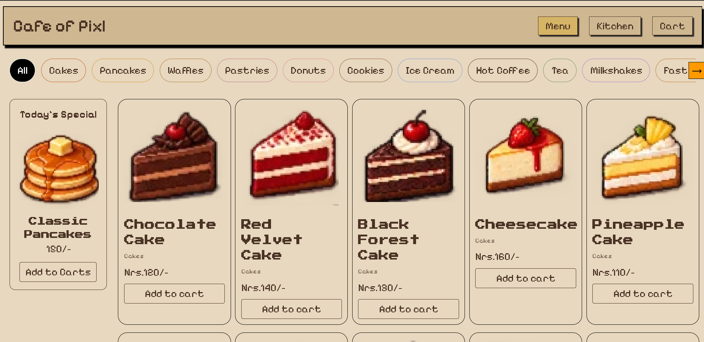
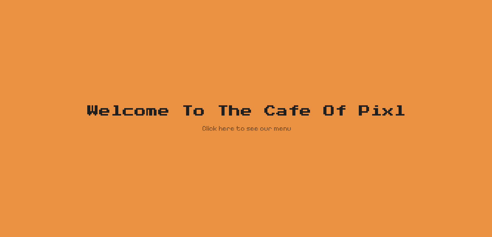
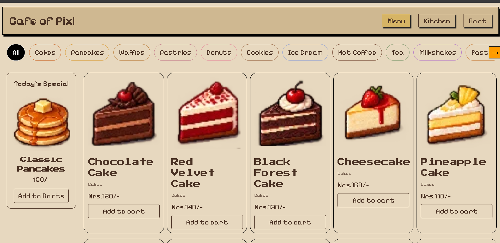
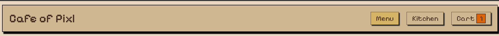
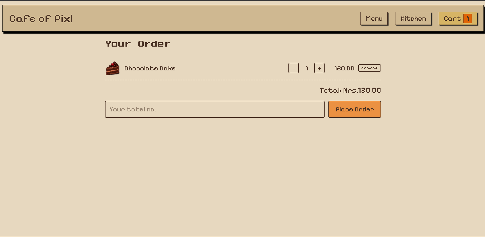
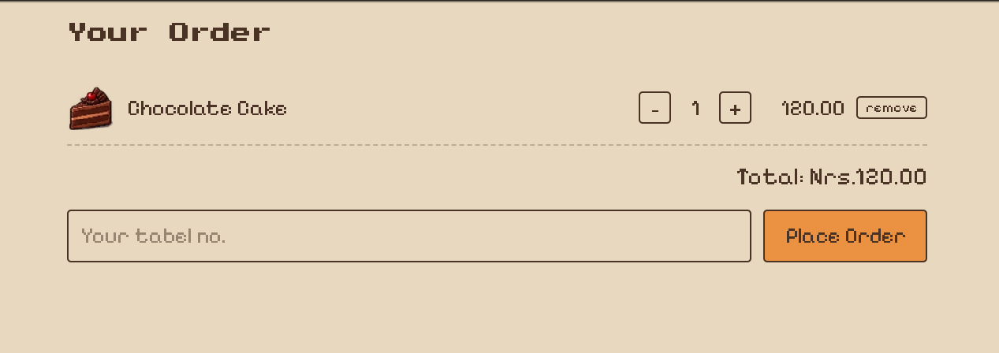
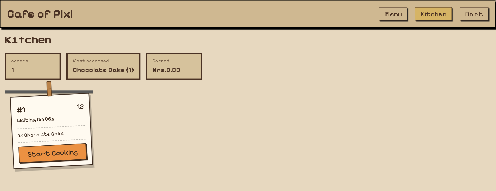
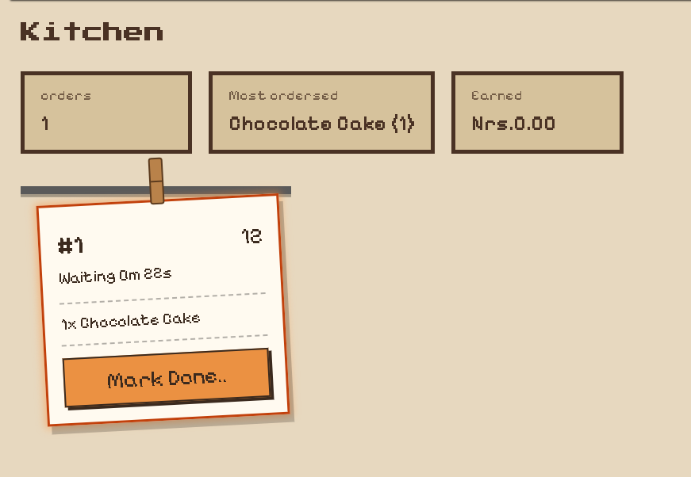
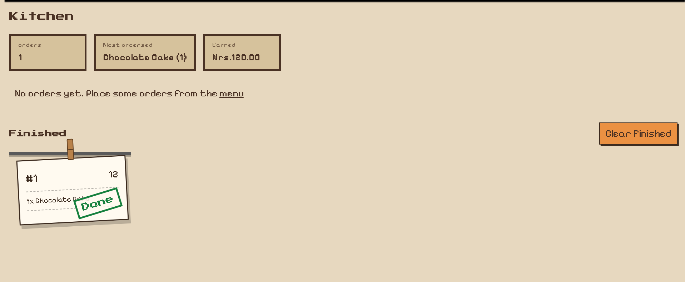

# Cafe Of Pixl

A cozy pixl art based cafe ordering menu system. Browse through the menu, fill up your tray, send the order, and watch it show up on the kitchen's ticket rail.

[**Live Demo**](https://cafe-of-pixl.vercel.app/)



## Why I made this Project?

This was my project for the Pixl Order up Quest, and I wanted it to feel like its a cozy tiny cafe you'd actually want to sit in, not a boring order form.

## How it works ? 
**Home**
- You open the website then you get welcomed by a welcome home page 


**Menu**
- Then you click it and you will see our menu not so fancy, it is with simple look and a cozy wibe 

Here, we have two section one is Today's special item section and the others are just regular items section and above them you have other categorize buttons for different type of dishes 

- On all the items we have there names and there price, select which item you want to have on your tray and place it by pressing add to cart button


**Cart**
- After you have selected the item and place it to the cart then you will see on top right there is a option for cart click on that and you will be on the cart page


- Press on the Place order or you can add, sub and remove the item from there by pressing those buttons.


**Kitchen**
- Once you placed  your order you will see order is sent to the kithens, you can click on that note or to the button above in the navigation tab



- In the kithcen all the items with the seat number you selected are shown once they are done then there will be mark done option and all 





## Try the full flow

1. Open the site and place an order from the cart page.
2. Open the Kitchen section in a **second tab of the same browser**.
3. Click "start cooking", then "Mark done".
4. switch back to the first tab. The status updates by itself.

## Build With

- React + vite
- React Router(Hash)
- React Context for the shared cart and orders
- Tailwind CSS And Plain Css a matte light creamy palette, Pixelify Sans and Press Start 2P

## What i still need to add in this :- 
1. I need to add a little comfy animation on kitchen where it shows diffrent cooking for the diffrent items to cook.
2. I need to Add a real backend system  so orders work across the devices
3. Need to make responsive it works perfect for the bigger display (Done)

## Run it locally

```
git clone https://github.com/asmitsingh000/Cafe-of-pixl.git
cd cafe-of-pixl
npm install
npm run dev
```
